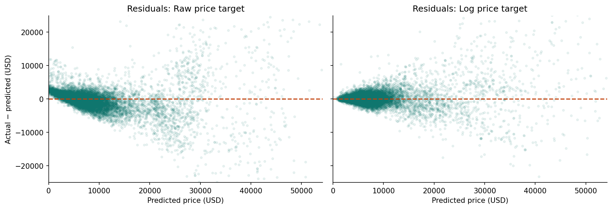
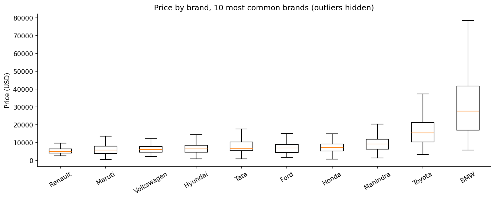
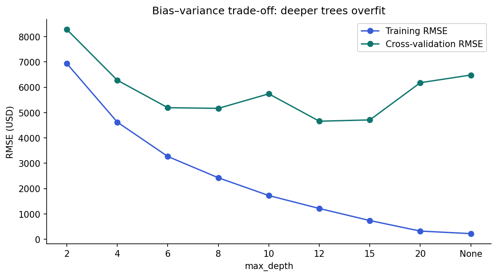
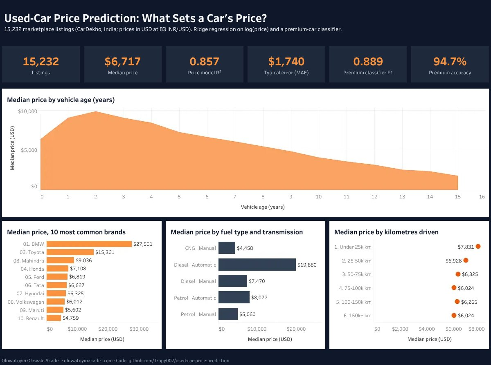

# Used-Car Price Prediction

Predicting fair selling prices for **15,232 used-car listings** with leak-free scikit-learn pipelines, and flagging cars likely to sell in the premium segment.

**Author:** Oluwatoyin Olawale Akadiri · [Portfolio](https://oluwatoyinakadiri.com) · [LinkedIn](https://www.linkedin.com/in/oluwatoyin-akadiri/)

## Results at a glance

| Task | Model | Held-out test result |
|---|---|---|
| Price prediction (regression) | Ridge regression on log(price) | **R² 0.857**, typical error (MAE) **$1,740**, RMSE $3,810 |
| Premium car (> $10,000) classification | Tuned gradient boosting | **F1 0.889**, accuracy 94.7%, recall 0.897 |

The test set was used **once**, after all model selection was done on training data with 5-fold cross-validation. Test scores closely match cross-validation scores, so the models generalize.

## Key findings

1. **Clean data first.** Removed 167 duplicate listings and 12 impossible mileage values (up to 3.8 million km), and treated zero-seat cars as missing.
2. **Model shape beat model complexity.** Car values fall by a percentage each year, so predicting log(price) cut cross-validated RMSE from $6,126 to $4,214 and eliminated 591 negative price predictions.
3. **Deep trees overfit.** Past depth 15, training error keeps falling while validation error rises.







## Interactive dashboard

[](https://public.tableau.com/app/profile/oluwatoyin.akadiri6432/viz/Used_Car_Price_Dashboard/UsedCarPrices)

**[Open the interactive dashboard on Tableau Public](https://public.tableau.com/app/profile/oluwatoyin.akadiri6432/viz/Used_Car_Price_Dashboard/UsedCarPrices)**

The packaged workbook is [`dashboard/Used_Car_Price_Dashboard.twbx`](dashboard/Used_Car_Price_Dashboard.twbx). [`dashboard/export_dashboard_data.py`](dashboard/export_dashboard_data.py) rebuilds the dashboard tables in `dashboard/data/` from this project's data and code.

## Methods

- Data cleaning and validation with **pandas**
- Feature engineering: km per year, power per litre, log mileage
- Stratified train/test split by price band
- `ColumnTransformer` pipelines (median imputation, scaling, one-hot encoding) so preprocessing is learned inside each CV fold
- Models compared against a baseline: linear, log-target linear, Ridge, decision tree; logistic regression, k-NN, random forest, gradient boosting
- Hyperparameter tuning with `GridSearchCV`

## Project structure

```
used-car-price-prediction/
├── notebooks/used_car_price_prediction.ipynb   # full analysis with outputs
├── images/                                     # charts used in this README
├── requirements.txt
└── README.md
```

## How to run

```bash
git clone https://github.com/Tropy007/used-car-price-prediction.git
cd used-car-price-prediction
pip install -r requirements.txt
jupyter notebook notebooks/used_car_price_prediction.ipynb
```

The notebook downloads the data automatically.

## Data

CarDekho used-car listings, a public dataset ([source](https://github.com/manishkr1754/CarDekho_Used_Car_Price_Prediction)). Prices are converted from Indian rupees at ₹83 = $1. The data is not redistributed in this repository.

## Limitations

Prices come from a single Indian marketplace and a fixed exchange rate. Listing date, location, and vehicle condition are not available and would likely improve accuracy.
